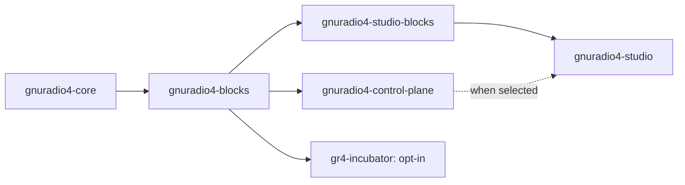

[](https://github.com/gnuradio/gnuradio4/actions/workflows/ci.yml)
[](https://github.com/gnuradio/gnuradio4/pkgs/container/gnuradio4-studio)

<p align="center">
  
</p>

# GNU Radio 4

This is the official repository and entry point for GNU Radio 4 (GR4).
[GNU Radio](https://www.gnuradio.org) is a free and open-source signal-processing runtime and software
development toolkit. GR4 provides a modern C++23 block API, runtime-loadable
blocks and schedulers, an installed development SDK, and browser and desktop
Studio applications. This repository is the top-level GR4 workspace: it builds
the independently maintained core, blocks, control-plane, and Studio
repositories in dependency order into one development prefix, with
experimental components available separately.

## Requirements

The core stack requires CMake 3.27+, Ninja, Git, and a C++23 compiler (GCC 14+
or a current Clang; GCC 15+ or Clang 20+ recommended). Building Studio also
requires Node.js 22 and npm.
Individual block families and desktop Studio can require additional system
packages. See the [Build guide](docs/building.md) for platform setup, profile
choices, and resource limits.

## Quick start

Clone the workspace and build core and standard blocks with the `dev` profile:

```sh
git clone https://github.com/gnuradio/gnuradio4.git
cd gnuradio4
cmake --preset dev
cmake --build --preset dev
source build/dev/activate.sh
```

The `full` profile also enables the ZeroMQ, SDR, and Audio block families and
builds control-plane, Studio C++ blocks, and the desktop Studio application:

```sh
cmake --preset full
cmake --build --preset full
source build/full/activate.sh
gr4-studio
```

Incubator is opt-in and is excluded from both `dev` and `full` by default. To
add it to the full workspace, configure with
`cmake --preset full -DGR4_MODULES=gr4-incubator` before building.

On Ubuntu hosts with restricted unprivileged user namespaces, run
`gr4-studio-sandbox-setup` once before launching Studio. See the
[Studio guide](docs/studio.md#desktop-studio) for details.

Run the published browser Studio image instead:

```sh
docker pull ghcr.io/gnuradio/gnuradio4-studio:latest
docker run --rm -p 8080:8080 ghcr.io/gnuradio/gnuradio4-studio:latest
```

Then visit <http://localhost:8080>.

The initial build clones missing component repositories into `src/`. After a
checkout exists, the superbuild leaves its Git state alone; you choose when to
fetch, update, or switch its branch.

Each profile has its own build directory and install prefix; `dev` installs
into `install/` and `full` into `install/full/`. Source the matching activation
script in the shell where you use the installed tools. To limit memory use,
set `CMAKE_BUILD_PARALLEL_LEVEL` before configuring; see
[Control parallelism](docs/building.md#control-parallelism).

Docker is the documented container host. Podman is supported as a rootless
alternative; see [CI and containers](docs/ci.md#docker-and-podman).

## Workspace components

The checked-in [module manifest](modules.cmake) defines the available modules
and their groups. The supplied `dev` profile selects `base`; `full` selects
`base` and `full`.

| Module | Purpose | Group |
| --- | --- | --- |
| `gnuradio4-core` | Runtime, schedulers, graph/block model, plugins, and SDK | `base` |
| `gnuradio4-blocks` | Standard signal-processing and utility blocks; reusable DSP algorithms and support libraries in `library/` | `base` |
| `gnuradio4-control-plane` | Runtime control service with HTTP and WebSocket APIs | `full`, `applications` |
| `gnuradio4-studio-blocks` | Studio-specific C++ blocks | `full`, `applications` |
| `gnuradio4-studio` | Browser and desktop Studio application | `full`, `applications` |
| `gr4-incubator` | Experimental blocks, schedulers, and utilities | `experimental` |

The two Studio modules share the `gnuradio4-studio` repository. The superbuild
builds and installs the desktop application; the published container provides
the browser application and its control-plane backend.

## Repository dependencies

The superbuild uses the following build ordering:



The reusable algorithm library lives in `gnuradio4-blocks/library/` and is
built and installed with blocks. Its installed `gnuradio4Library` CMake package
is available to incubator and out-of-tree consumers.

Control-plane compiles against core; the superbuild orders it after blocks so
the standard runtime plugin catalog is available. Studio blocks build before
the application, which also builds after control-plane when both are selected.
At runtime, control-plane discovers installed block plugins, and Studio
communicates with it through HTTP and WebSocket APIs. Studio can also connect
to a remote control-plane service.

The superbuild coordinates the repositories it includes; OOTs remain
independently owned and can be added to the workspace as described in the
[extending guide](docs/extending.md).

## Documentation

| Task | Documentation |
| --- | --- |
| Configure, build, select a profile, or use macOS | [Build guide](docs/building.md) |
| Select modules or register a workspace module | [Module configuration](docs/modules.md) |
| Launch desktop or browser Studio | [Studio guide](docs/studio.md) |
| Run component and integration tests | [Testing guide](docs/testing.md) |
| Develop a child repository or add an out-of-tree project | [Extending the workspace](docs/extending.md) |
| Understand CI and test/container image policy | [CI and containers](docs/ci.md) |
| Understand the superbuild's architectural choices | [Design](DESIGN.md) |

## Common commands

```sh
# Run integration checks, including an installed-SDK consumer smoke test.
cmake --build --preset dev --target check

# Also check the installed control plane and plugin catalog (configure full first).
cmake --build --preset full --target check

# List the supplied configure and build profiles.
cmake --list-presets
cmake --build --list-presets

# Build standard blocks and their required dependencies.
cmake --build --preset dev --target gnuradio4-blocks
```

Component unit tests and Studio lint/tests run in their owning repositories'
CI. The workspace `check` target covers integration and any local modules
explicitly registered with `TESTS`; see the [Testing guide](docs/testing.md).

## Contributing

The repositories under `src/` are ordinary Git working copies. Make component
changes in their owning repository and follow that repository's contribution
guidance. This workspace owns cross-component build orchestration, integration
CI, and shared development workflows.

See [Contributing](CONTRIBUTING.md) for repository ownership, pull requests,
and the required DCO sign-off. All participants must follow the
[Code of Conduct](CODE_OF_CONDUCT.md).

## Helpful links

- [GNU Radio website](https://gnuradio.org/)
- [GNU Radio wiki](https://wiki.gnuradio.org/)
- [GNU Radio Matrix chat](https://chat.gnuradio.org/)
- [GNU Radio 4 technical discussion](https://matrix.to/#/#gr4-technical-users:gnuradio.org)

## Acknowledgements

GNU Radio acknowledges GSI/FAIR (Facility for Antiproton and Ion Research,
Darmstadt, Germany) and the wider GNU Radio community for their contributions
to the design and development of GNU Radio 4.0.

## License

The superrepo's CMake orchestration, CI configuration, helper scripts, and
documentation are distributed under the [MIT License](LICENSE). Individual
component repositories retain their own authoritative licensing and
contribution terms.
